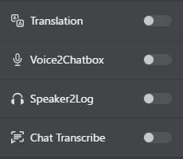

# Chat Transcribe (OCR)

Since **v3.6.0**, VRCT can read the chat bubbles that VRChat shows on screen, then translate the text with the same translation pipeline used for other messages. This is useful when other players talk in a language you do not understand and you cannot hear it clearly, or when you want to read text that appears only in chat.

## Overview

When Chat Transcribe is on, the chat bubbles in VRChat are read and translated. The results appear in the message log and the SteamVR overlay.

:::info[Output destination]
Recognized chat is **never sent to the VRChat chatbox**. Results appear only in VRCT's message log and the SteamVR overlay. This keeps other players' messages from being echoed back into your own chatbox.
:::

## How to Enable

1. In the main window, locate the **Chat Transcribe** toggle switch in the transcription controls.
2. Click it to start. The toggle turns on while capture is running.

If Chat Transcribe cannot start (for example, because the OCR model is not ready or the selected source language is not supported), VRCT shows a notification with the reason.

## Configuration

Open the Config Window and go to the **Chat Transcribe** tab. For each option, see the [Chat Transcribe Tab](/docs/config-chat-transcribe) page.

| Setting | Default | Purpose |
|---------|---------|---------|
| Source language | Auto | Language of the chat bubbles |
| Window name | VRChat | Part of the window title used to find the capture target |
| Capture interval (ms) | 750 | How often a new frame is captured |
| Minimum confidence | 0.85 | Text below this OCR confidence is discarded |
| Minimum text length | 2 | Bubbles with fewer characters are ignored |

### Source Language

- **Auto** reads Japanese, English, Chinese, and other Latin-script languages with one model. Use it unless you need one of the options below.
- **Korean**, **Russian**, **Ukrainian**, **Thai**, **Arabic**, and **Hindi** use a separate model for each writing system, so select the one that matches the chat you read.
- Arabic accuracy is currently low.

Changing the source language while Chat Transcribe is running switches the model without restarting it.

## Which Window Is Captured

- **While SteamVR is running**, VRCT reads the VRChat view from SteamVR.
- **Otherwise**, VRCT captures the window whose title contains the **Window name** (case-insensitive). Change this value only if you run a VRChat client whose window title is different (for example, a modified launcher).

## Performance

Chat Transcribe runs OCR on a regular interval, so it adds CPU or GPU load while it is on.

- Increase the **Capture interval** to reduce load. Decrease it if you want faster responses.

## Troubleshooting

- **Nothing is recognized**
    - Check that the **Source language** matches the chat you are reading.
    - Check the **Window name** if you use a client that is not titled "VRChat".
    - Lower the **Minimum confidence** slightly to catch faint bubbles.
- **Too many wrong results or noise**
    - Raise the **Minimum confidence**.
    - Raise the **Minimum text length** to ignore short fragments.
- **High CPU or GPU usage**: increase the **Capture interval**.

## Related Features

- [Real-time Translation](/docs/feature-guide/translation) - How translated output is handled
- [VR UI (Beta)](/docs/feature-guide/vr-ui) - Turn Chat Transcribe on and off from inside VR
