# Main Window Overview

Here is an overview of the VRCT main window and its features.

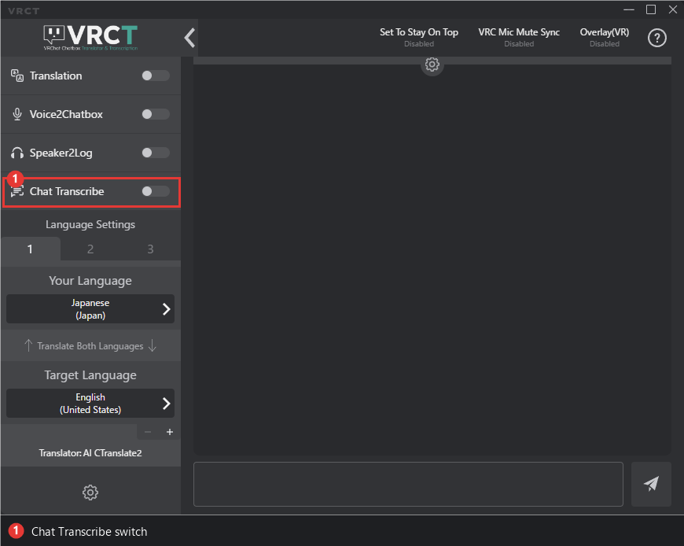

## Translation Toggle Switch
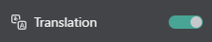  
When enabled, messages will be translated.

## Transcription Controls
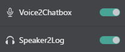  
Controls the microphone, speaker, and chat transcription.
- **Voice2Chatbox** Toggle Switch: Toggles microphone transcription (Voice to Text).
- **Speaker2Log** Toggle Switch: Toggles speaker transcription (System Audio to Text).
- **Chat Transcribe** Toggle Switch: Toggles reading VRChat chat bubbles on screen. Results are translated and shown in the message log and the SteamVR overlay, but are not sent to the VRChat chatbox. See the [Chat Transcribe guide](/docs/feature-guide/chat-transcribe).

## Set To Stay On Top Toggle Switch
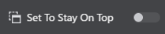  
Keeps the VRCT main window on top of other windows when enabled.  
It is in the top bar, and you can switch it on or off directly with one click.

## Language Settings
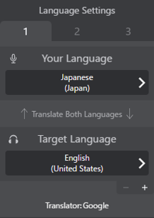  
Displays the currently selected languages.
- **Your Language**: The language you are speaking or writing.
- **Target Language**: The language you want to translate to.

### Preset Tab
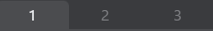  
You can set up to three language presets.  
**Preset 1, 2, 3**: Click to switch between presets.

### Your Language / Target Language
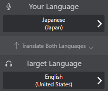  
Click on a language area in **Your Language** / **Target Language** to display the language selection menu.  
Please select the language you need for communication.  
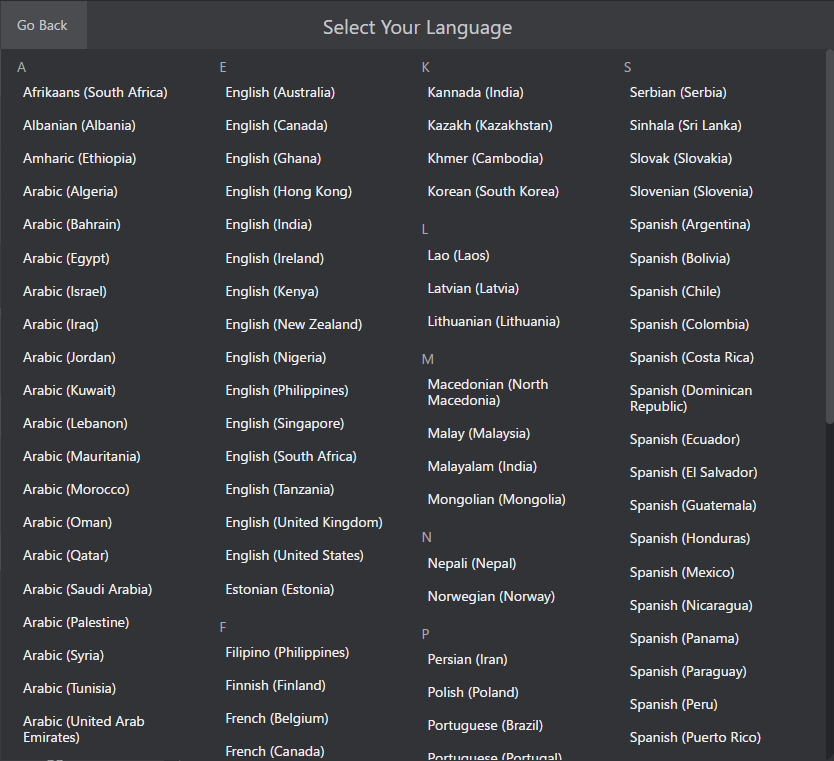

### Swap Languages
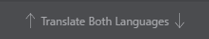  
Clicking this area allows you to quickly swap or change languages.

### Additional Target Language
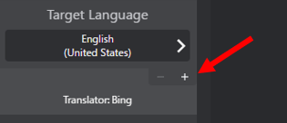  
You can add an additional target language for translation.
- Click the **[+]** button to add another target language.  
- Up to 3 target languages can be added.  
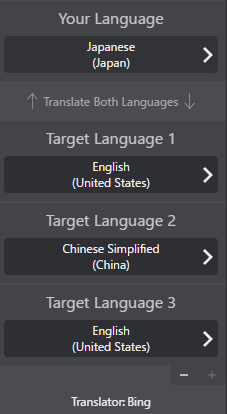
- Click the **[-]** button to remove the additional target language.

:::tip[tip]
When multiple target languages are set, the translated messages will be displayed in the order of the target languages set.
:::

### Translation Engine Selection
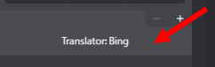  
You can select translation engines.
- Click the translation engine name area to display the selection menu.  
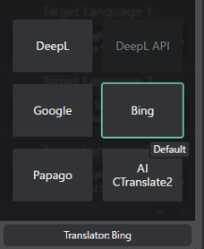
- Select the translation engine you want to use for that target language.
    - Google, DeepL, Bing, Papago, etc.
    - API-based engines
    - AI-based engines
    - others (continuously adding...)
- default engines are AI Translation(m2m100 model).
    - Reference : https://huggingface.co/docs/transformers/model_doc/m2m_100
    - You can select different AI models in the Config Window. Refer to the [Translation Guide](./config-translation).

## Chat History
Displays the conversation history.
- **Left side**: Messages received from others.
- **Right side**: Messages sent by you.
Each message shows the original text and the translated text.

## Input Field
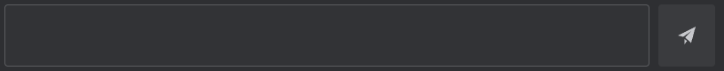  
Type your message here to send it via chat.
- Click the Right side Button to send the message.
- You can use the following keyboard shortcuts:
    - Press **Enter** to send.
    - Press **Shift + Enter** to insert a line break.
    - Press **Shift + Up Arrow** to recall the last sent message for editing.

## Configuration Button
  
Opens the Config Window where you can configure VRCT options.
For details, refer to the [Config Window Guide](./config-window).

## VRC Mute Sync Button
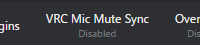  
Switches VRC Mute Sync on or off directly, without a pop-up.  
When enabled, VRCT will synchronize the mute status between VRChat and VRCT.  
This button is unavailable while the OSC settings prevent VRCT from receiving OSC data.  
For details, refer to the [VRC Mute Sync Guide](./config-other#general).

## Update Button
When a new version of VRCT is available, an update button appears in the top bar.  
Select it to open the Updater screen, where you can install the latest version or choose another version and build. See the [Updater Tab](./config-updater) page for details.

## Overlay(VR) Button
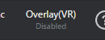  
Opens the Overlay(VR) Config Window.
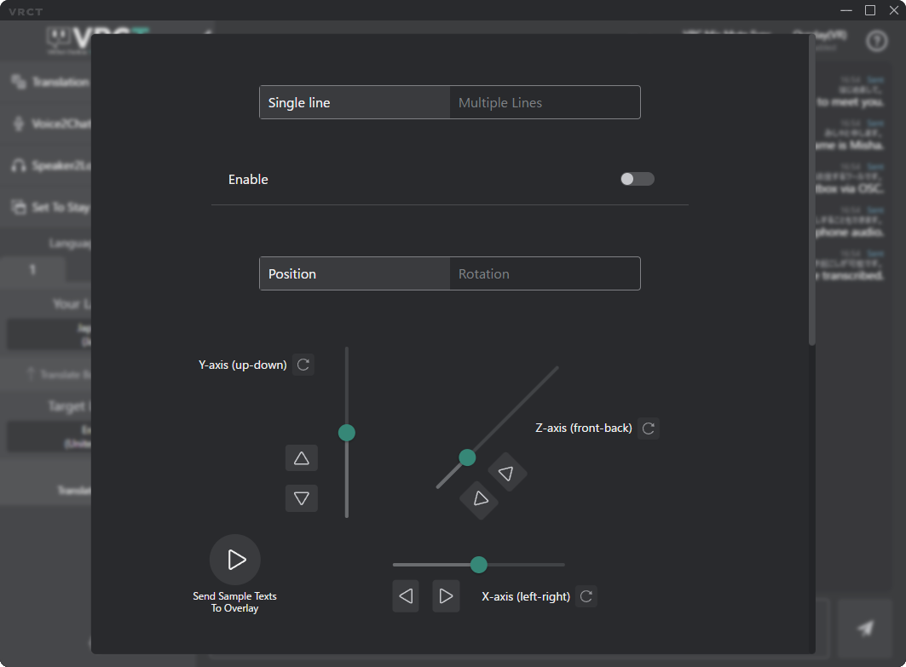  
For details, refer to the [Overlay(VR) Guide](./config-vr).

## Help Button
  
Opens the help menu with links to documentation.

## Message Log Font Size Slider
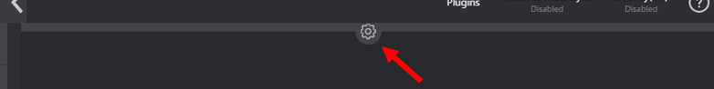  
Opens the font size slider window.
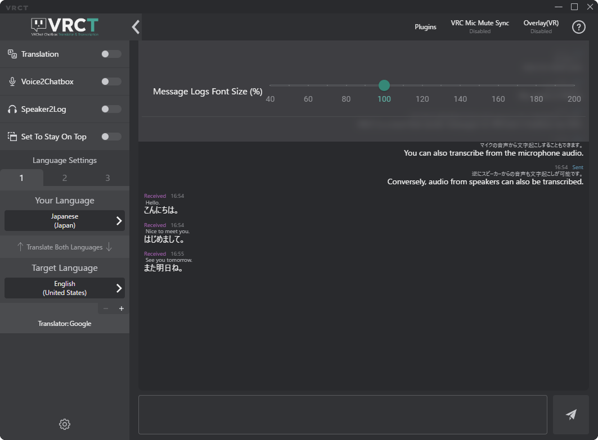
- Slider: Adjust the Message Log font size.
- Default size is 100.