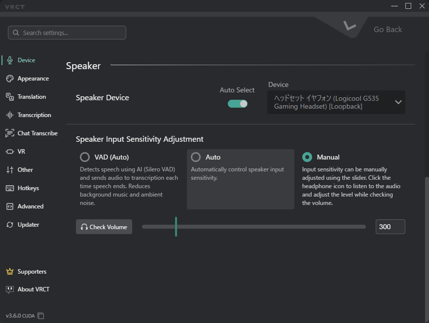

# Device Tab
Customize your audio input and output devices.  
The tab is split into a **Mic** section and a **Speaker** section.

## Mic
Select the microphone for your voice input.

- **Auto Select**: Automatically selects the default system microphone.
- **Host/Driver**: Manually choose a specific microphone from the list.
    - **Host**: The audio host (e.g., MME, WASAPI, DirectSound).
- **Device**: The specific microphone device available under the selected host.

### Mic Sensitivity Settings

Choose how VRCT decides when your voice is speech. Select one of the three options:

- **VAD (Auto)**: Uses an AI voice activity detector (Silero VAD) to find speech. Audio is sent to transcription each time you finish speaking. This helps reduce background music and ambient noise.
    - The sensitivity slider is disabled in this mode.
- **Auto**: Automatically controls the mic input sensitivity.
    - The sensitivity slider is disabled in this mode.
- **Manual**: Set the sensitivity yourself with the slider.
    - **Check Volume**: Click the mic icon to test your voice and watch the level while you adjust the slider.
    - **Volume Slider**: Manually adjust the mic sensitivity level.

:::tip[tip]
Start with **VAD (Auto)** if your mic picks up game or music audio. Switch to **Manual** if speech is cut off too early or missed.
:::

## Speaker

Select the speaker or headphones for receiving audio to be translated.

- **Auto Select**: Automatically switches to the output device that is actually playing sound (since v3.5.0). You no longer need to reselect the speaker device when the output of a game or call changes.
- **Device**: The specific speaker device available under the selected host.
    - Speaker Host/Driver is WASAPI only. Cannot be changed.

:::note[v3.5.0]
The audio pipeline was reworked for stability. Hangs when switching devices and false loopback detections were resolved. A stalled audio stream recovers automatically.
:::

### Speaker Input Sensitivity Adjustment
The same three options are available for the speaker input:

- **VAD (Auto)**: Uses Silero VAD to detect speech in the speaker audio and transcribes each segment when speech ends.
- **Auto**: Automatically controls the speaker input sensitivity.
- **Manual**: Set the sensitivity yourself with the slider.
    - **Check Volume**: Click the headphone icon to listen to the audio and adjust the level while checking the volume.
    - **Volume Slider**: Manually adjust the speaker input sensitivity level.
