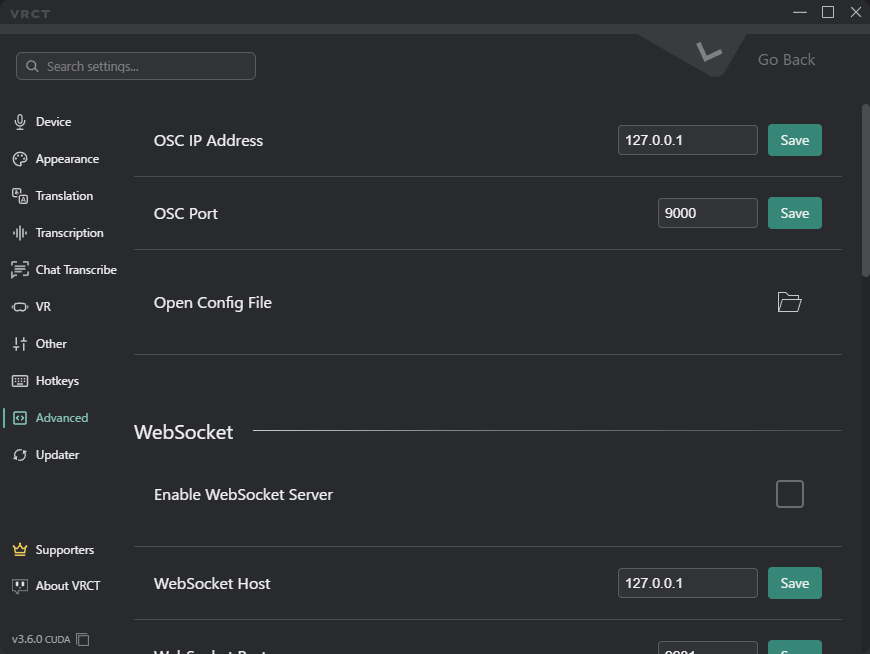
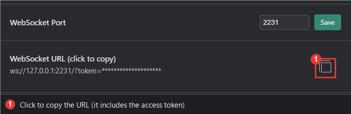
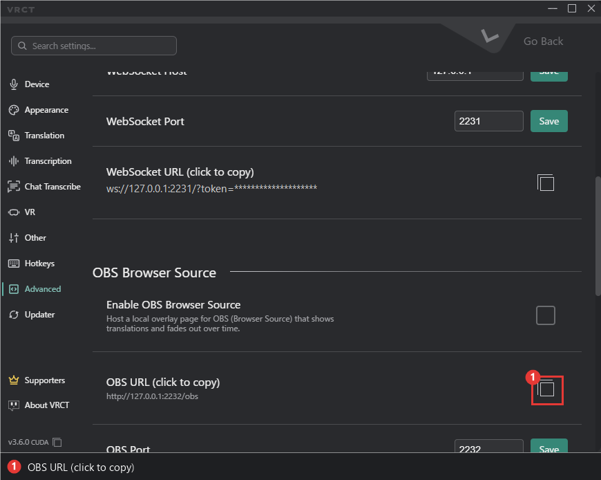

# Advanced Settings Tab
Configure advanced options in the Advanced Settings tab of the VRCT configuration.

:::info[CPU/GPU version]
To switch between the CPU and GPU (CUDA) builds of VRCT, use the [Updater Tab](./config-updater).
:::

## General

- **OSC IP Address**: Set the IP address for OSC communication.
- **OSC Port**: Specify the port number for sending OSC messages.
- **Open Config File**: Open the VRCT configuration file for manual editing.

## WebSocket

- **Enable WebSocket Server**: Enable or disable WebSocket communication.
    - This cannot be changed while the [OBS Browser Source](/docs/feature-guide/obs-browser-source) is enabled.
- **WebSocket Host**: Set the IP address for WebSocket communication.
    - Wildcard addresses such as `0.0.0.0` and `::` cannot be used.
- **WebSocket Port**: Specify the port number for WebSocket communication.
- **WebSocket URL (click to copy)**: Copies the connection URL, including the access token, to the clipboard.
    - The URL looks like `ws://127.0.0.1:2231/?token=...`.
    - Clients must include the `token` parameter. A connection without the correct token is rejected.

For how external applications use the WebSocket server, see the [WebSocket Integration](/docs/feature-guide/websocket-integration) guide.

## OBS Browser Source

The OBS Browser Source settings (enable, URL, port, and display options) are in this tab as well. See the [OBS Browser Source](/docs/feature-guide/obs-browser-source) guide.
