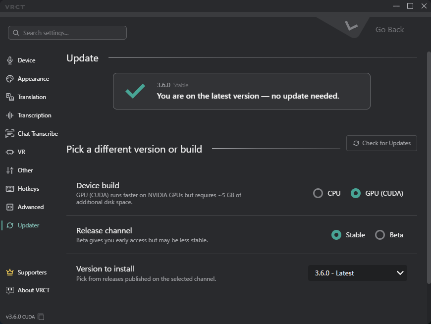

# Updater Tab
Check for updates and install a version of VRCT in the Updater Tab of the Config Window. This one screen covers the release channel, the CPU or GPU build, and the version you install, including going back to an earlier version.

When a new version is available, the main window shows an update notice. Selecting it opens the same screen as a pop-up.

:::info[v3.6.0+]
Choosing an earlier version is available from v3.6.0 onward. You cannot go back to a version earlier than v3.6.0 from this screen.
:::

## Current Status
The top of the tab shows the version you are running and its release channel (Stable or Beta).  
If you are on the latest version, a message says no update is needed.

## Choose Version and Build

Choose the setup you want to install.

- **Release Channel**: Choose **Stable** or **Beta**.
    - Beta gives you early access, but it may be less stable.
    - Switching channels changes which releases future update notifications follow. A warning is shown when you switch.
- **Device build**: Choose **CPU** or **GPU (CUDA)**.
    - **GPU (CUDA)** can run faster on NVIDIA GPUs, but it needs about 5 GB of additional disk space and download.
- **Version to Install**: Choose the release to install. The list shows releases on the channel you selected.
    - Choose a past release to downgrade. Config file compatibility is not guaranteed when you downgrade.
    - If no release is available on the selected channel, the list shows a message.

Use **Check for Updates** to refresh the list of releases.

## Review the Change
Before you install, a table compares the **Current** setup with the setup **After install**, so you can see what will change.

Warnings appear in these cases:
- Downgrading to an earlier version
- Switching to the GPU (CUDA) build, which needs additional download size
- Switching the release channel

## Install
The button label changes to match your selection.

- **Update to Latest Version**: Shown when the latest version is selected.
- **Install with This Setup** or **Reinstall with This Setup**: Shown for other choices, such as a past version, a different device build, or the same version with different settings.

## Related
- [Installation](/docs/installation): How to install VRCT for the first time
- [Advanced Tab](./config-advanced): Config file and network settings
