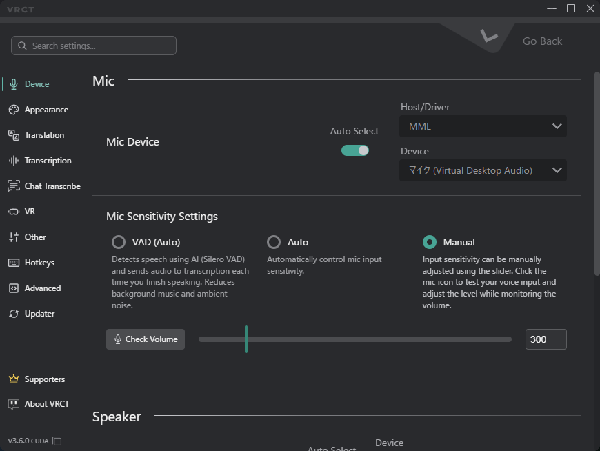

# Config Window Overview

The Config Window allows you to customize various aspects of VRCT, from appearance to translation engines.   
Click the **gear icon (⚙️)** on the main window to open it.

## Search Settings
Use the search bar at the top of the Config Window to find a setting by name. Results show the tab each setting belongs to.

## Device Tab
Manage your audio input and output devices, including the mic sensitivity mode (VAD, Auto, or Manual).  
Refer to the [Device Tab](./config-device) page for more details.

## Appearance Tab
Customize the look and feel of the application.  
Refer to the [Appearance Tab](./config-appearance) page for more details.

## Translation Tab
Configure the translation engines. The tab is grouped into **AI Translation (Local)**, **External Translation API**, and **Local LLM & Compatible Server**.  
Refer to the [Translation Tab](./config-translation) page for more details.

## Transcription Tab
Configure the transcription engines.  
Refer to the [Transcription Tab](./config-transcription) page for more details.

## Chat Transcribe Tab
Configure how VRCT reads VRChat chat bubbles on screen: the source language, capture target, and recognition thresholds.  
Refer to the [Chat Transcribe Tab](./config-chat-transcribe) page for more details.

## VR Tab
Configure VR-related settings, including the subtitle overlays and the VR UI (Beta).  
Refer to the [VR Tab](./config-vr) page for more details.

## Other Tab
Configure other miscellaneous settings.  
Refer to the [Other Tab](./config-other) page for more details.

## HotKeys Tab
Configure keyboard shortcuts for various actions in VRCT.  
Refer to the [HotKeys Tab](./config-hotkeys) page for more details.

## Advanced Settings Tab
Advanced configuration options for VRCT, including the WebSocket server.  
Refer to the [Advanced Settings Tab](./config-advanced) page for more details.

## Updater Tab
Check for updates, choose a release channel and CPU or GPU build, and install a specific version.  
Refer to the [Updater Tab](./config-updater) page for more details.
