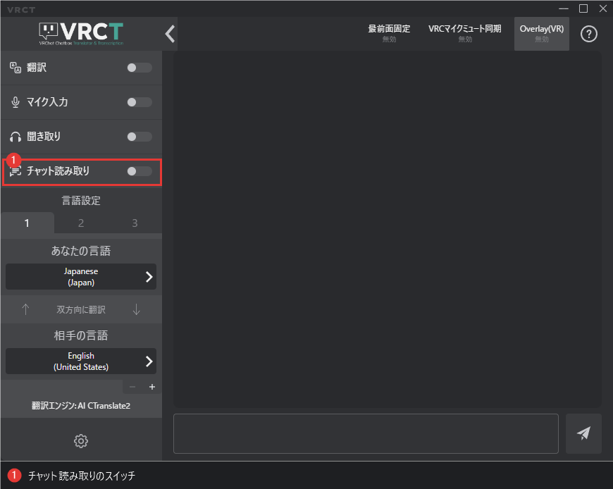

# チャット読み取り（OCR）

**v3.6.0**から、VRCTは画面に表示されるVRChatのチャット吹き出しを読み取り、他のメッセージと同じ翻訳パイプラインで翻訳できるようになりました。他のプレイヤーが聞き取りにくい言語で話している場合や、チャットに表示される文字だけを読みたい場合に便利です。

## 概要

チャット読み取りをオンにすると、VRChatに表示されるチャット吹き出しの文字を読み取って翻訳します。結果はメッセージログとSteamVRオーバーレイに表示されます。

:::info[出力先]
チャット読み取りの結果は**VRChatのチャットボックスへは送信されません**。結果はVRCTのメッセージログとSteamVRオーバーレイにのみ表示されます。他のプレイヤーのメッセージを自分のチャットボックスへ送り返さないための仕様です。
:::

## 有効にする方法

1. メインウィンドウの文字起こしの操作欄にある**チャット読み取り**トグルスイッチを探します。
2. クリックして開始します。キャプチャ中はトグルがオンになります。

チャット読み取りを開始できない場合（OCRモデルの準備ができていない、選択した読み取り言語に対応していない、など）は、理由を通知します。

## 設定

コンフィグウィンドウを開き、**チャット読み取り**タブを選択します。各項目の詳細は[チャット読み取りタブ](/docs/config-chat-transcribe)を参照してください。

| 設定 | 初期値 | 用途 |
|------|--------|------|
| 読み取り言語 | 自動 | チャット吹き出しの言語 |
| ウィンドウ名 | VRChat | キャプチャ対象を探すためのウィンドウタイトルの一部 |
| キャプチャ間隔（ms） | 750 | 新しいフレームをキャプチャする間隔 |
| 最小信頼度 | 0.85 | OCRの信頼度がこの値未満の文字を破棄します |
| 最小文字数 | 2 | この文字数未満の吹き出しを無視します |

### 読み取り言語

- **自動**：日本語、英語、中国語、その他のラテン文字系の言語を1つのモデルで読み取ります。下記の選択肢が不要な場合は、この設定のままで使用してください。
- **韓国語**、**ロシア語**、**ウクライナ語**、**タイ語**、**アラビア語**、**ヒンディー語**：文字体系ごとに別のモデルを使用します。読みたいチャットの言語に合わせて選択してください。
- アラビア語の精度は現時点では低めです。

チャット読み取りの実行中に読み取り言語を変更しても、再起動せずにそのまま切り替わります。

## キャプチャ対象

- **SteamVRの起動中**は、SteamVRの画面からVRChatの表示を読み取ります。
- **それ以外の場合**は、タイトルに**ウィンドウ名**を含む（大文字小文字を区別しない）ウィンドウをキャプチャします。VRChatのウィンドウタイトルが異なるクライアント（改造版ランチャーなど）を使う場合のみ変更してください。

## パフォーマンス

チャット読み取りは一定間隔でOCRを実行するため、オンの間はCPUまたはGPUの負荷が増えます。

- 負荷を下げたい場合は**キャプチャ間隔**を長くしてください。反応を速くしたい場合は短くしてください。

## トラブルシューティング

- **何も認識されない**
    - **読み取り言語**が読みたいチャットの言語と合っているか確認してください。
    - VRChatのウィンドウタイトルが「VRChat」以外の場合は、**ウィンドウ名**を確認してください。
    - 薄い吹き出しを拾うには、**最小信頼度**をわずかに下げてください。
- **誤認識やノイズが多い**
    - **最小信頼度**を上げてください。
    - 短い断片を無視するには、**最小文字数**を上げてください。
- **CPUやGPUの使用率が高い**：**キャプチャ間隔**を長くしてください。

## 関連機能

- [翻訳](/docs/feature-guide/translation)：翻訳結果の扱い
- [VR UI（β版）](/docs/feature-guide/vr-ui)：VRの中からチャット読み取りをオン/オフ
