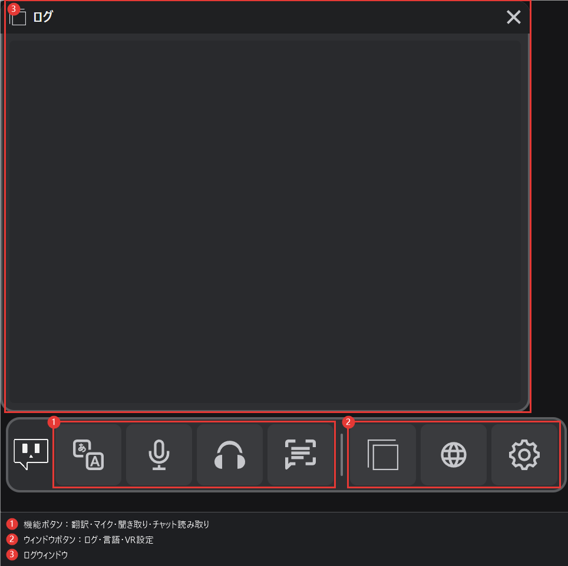

# VR UI（β版）

**v3.6.0**から、VRの中からVRCTを操作できる**VR UI**が使えるようになりました。左手首にランチャーが表示され、ログ、言語、VR設定のウィンドウを開けます。ヘッドセットを外さずに、翻訳、マイク（Voice2Chatbox）、スピーカー（Speaker2Log）、チャット読み取りをオン/オフできます。

:::caution[β版]
VR UIはβ版です。今後のリリースで、レイアウトや動作が変わる場合があります。
:::

VR UIは、[オーバーレイモード](./overlay-mode)で説明している字幕オーバーレイとは別の機能です。どちらか一方、または両方を使用できます。

## 必要な環境

- VRセッションが有効であること（SteamVRまたは互換性のあるOpenVRランタイム）
- コンフィグウィンドウの[VRタブ](/docs/config-vr)で**VR UIを表示する**がオンになっていること

## VR UIをオンにする

1. コンフィグウィンドウを開き、**VR**タブを選択します。
2. **VR UI（β版機能）**の**VR UIを表示する**をオンにします。

非表示にするには、この項目をオフにします。

## ランチャー

ランチャーは、初期状態では**左手首**に表示される細長い帯です。

- **ボタン**：機能をオン/オフします。ボタンは**翻訳**、**マイク**、**聞き取り**、**チャット読み取り**です。ボタンの吹き出しを有効にしている場合は、ボタンを指すと操作名と現在の状態が表示されます。
- **ウィンドウ**：**ログ**、**言語**、**VR設定**のウィンドウを開きます。

:::tip[ランチャーの位置]
ランチャーが見つからなくなった場合は、コンフィグウィンドウのVRタブで**ランチャーの位置と大きさを初期に戻す**を押してください。ランチャーは既定の位置と大きさで左手首に戻ります。
:::

### ランチャーの設定

これらの設定は、VRの中のVR設定ウィンドウで変更します。

- **ランチャーを付ける手**：ランチャーを付ける手を選びます。もう片方の手のレーザーでランチャーを押します。
- **手首を見たときだけ表示**：手首を顔の方に向けたときだけランチャーを表示します。
- **操作の吹き出し**：ボタンを指したときに、操作名と状態を表示します。

## フローティングウィンドウ

各ウィンドウは、コントローラーで移動やサイズ変更ができます。

- **移動**：ウィンドウをグリップでつかんで動かします。
- **押し引き**：ウィンドウを手前に引いたり奥に押したりします。
- **サイズ変更**：ウィンドウを拡大または縮小します。ログウィンドウは角をつかんでサイズを変更することもできます。
- **固定先**：ウィンドウを、ワールド、左手、右手、頭のいずれかに固定します。
- **ロック**：ウィンドウをつかんで動かせないようにします。もう一度押すとロックを解除できます。
- **呼び戻す**：ウィンドウが視界から外れた場合に呼び戻します。ログウィンドウの場合は、ワールドの固定先に移動します。

### ログウィンドウ

- **文字の大きさ**：14から28の範囲で変更できます。翻訳結果の文字も同じ大きさで変わります。
- **不透明度**：押すたびに、100%、80%、60%、40%、100%の順に変わります。
- **字幕オーバーレイ**：字幕オーバーレイは別の機能です。詳しくは[オーバーレイモード](./overlay-mode)を参照してください。

### 言語ウィンドウ

言語ウィンドウを使うと、VRの中から自分の言語と相手の言語を変更できます。

- プリセットを切り替えたり、自分の言語と相手の言語の1つ目を入れ替えたりできます。相手の言語は1〜3個の範囲で追加や削除ができます。
- 変更の反映には少し時間がかかります。反映が終わるまで、このウィンドウの画面に留まってください。

### VR設定ウィンドウ

VR設定ウィンドウでは、よく変更する設定にすぐアクセスできます。

- マイクとスピーカーの感度
- スピーカーの区切り方や残す単語の調整
- 字幕オーバーレイの設定
- 音量の確認

ウィンドウが開いている間や、必要なデバイスやモデルの準備ができていない場合は、一部の設定を変更できません。その場合は、PCの設定画面で確認してください。

## 設定を開いている間の翻訳と文字起こし

VR設定ウィンドウを開いている間、VRCTは**翻訳と文字起こしを一時停止**します。ウィンドウを閉じると再開します。

## トラブルシューティング

- **ランチャーが表示されない**：VRタブで**VR UIを表示する**がオンになっているか、SteamVRが起動しているかを確認してください。
- **ランチャーの位置がおかしい**：VRタブの**ランチャーの位置と大きさを初期に戻す**を使ってください。
- **ウィンドウが見当たらない**：ウィンドウの**呼び戻す**を使うか、ランチャーの位置を初期に戻してください。
- **ボタンが反応しない**：VRのコントロールは、コンフィグウィンドウが開いている間はロックされています。コンフィグウィンドウを閉じてから操作してください。変更の反映が終わるまで、もう一度押すのは待ってください。
