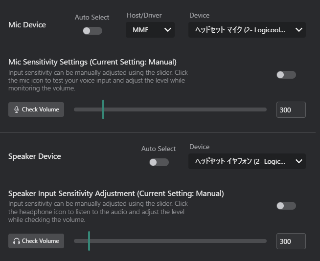

# デバイスタブ
オーディオ入力および出力デバイスをカスタマイズします。  
タブは**マイク**セクションと**スピーカー**セクションに分かれています。  

## マイク
音声入力用のマイクを選択します。

- **自動選択**：デフォルトのシステムマイクを自動的に選択します。
- **ホスト/ドライバ**：リストから特定のマイクを手動で選択します。
    - **ホスト**：オーディオホスト（例：MME、WASAPI、DirectSound）。
- **デバイス**：選択されたホスト下で利用可能な特定のマイクデバイス。

### マイク感度の設定
VRCTが、どの音声を話し声として扱うかを決める方法を選びます。3つのうちから1つを選択します。

- **VAD（自動）**：AIの音声区間検出（Silero VAD）で話し声を見つけます。話し終わるたびに、その音声を文字起こしに送ります。BGMや環境音の誤認識を抑えやすくなります。
    - このモードでは感度のスライダーは無効になります。
- **自動**：マイクの入力感度を自動的に調整します。
    - このモードでは感度のスライダーは無効になります。
- **手動**：スライダーで感度を自分で調整します。
    - **音量を確認**：マイクのアイコンを押して声を入力し、レベルを見ながらスライダーを調整できます。
    - **音量スライダー**：マイク感度レベルを手動で調整します。

:::tip[tip]
ゲームや音楽の音がマイクに入ってしまう場合は、まず**VAD（自動）**を試してください。話の途中で切れてしまう場合や、声を拾わない場合は**手動**に切り替えてください。
:::

## スピーカー
翻訳する音声を受信するためにスピーカーまたはヘッドフォンを選択します。

- **自動選択**：デフォルトのシステムスピーカーを自動的に選択します。
- **デバイス**：選択されたホスト下で利用可能な特定のスピーカーデバイス。
    - スピーカーホスト/ドライバはWASAPIのみです。変更できません。
- **再生中の音声エンドポイントを自動追従**（v3.5.0〜）：ピークレベルを監視し、実際に音が鳴っている出力デバイスへ自動的に切り替えます。ゲームや通話の音声出力先が切り替わっても、手動でスピーカーデバイスを選び直す必要がなくなります。

{/* TODO(v3.5.0): replace with ./img/config-device-speaker-follow-endpoint.png */}

:::note[v3.5.0]
音声処理の安定性が大幅に見直され、デバイス切り替え時のハングやスピーカーループバックの誤検知が解消されました。ストールした音声ストリームからは自動で復帰します。
:::

### スピーカー入力感度の調整
スピーカー入力にも、同じ3つのモードがあります。

- **VAD（自動）**：Silero VADでスピーカーの音声から話し声を見つけ、話し終わるたびに文字起こしします。
- **自動**：スピーカー入力の感度を自動的に調整します。
- **手動**：スライダーで感度を自分で調整します。
    - **音量を確認**：スピーカーのアイコンを押して音を聞きながら、レベルを確認して調整できます。
    - **音量スライダー**：スピーカー入力の感度レベルを手動で調整します。
