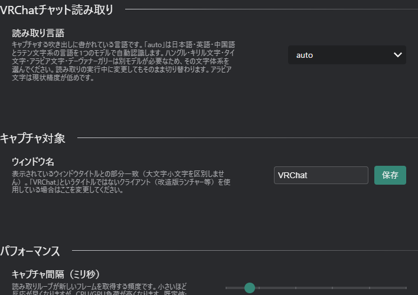

# チャット読み取りタブ
コンフィグウィンドウのチャット読み取りタブで、VRChatのチャット吹き出しを読み取る方法を設定します。  
機能の仕組みと有効にする方法は、[チャット読み取りガイド](/docs/feature-guide/chat-transcribe)を参照してください。

:::info[出力先]
チャット読み取りで読み取った文字は、メッセージログとSteamVRオーバーレイに表示されます。VRChatのチャットボックスへは送信されません。
:::

## キャプチャ対象

- **ウィンドウ名**：VRChatのウィンドウを探すための文字列です（大文字小文字を区別せず、部分一致で検索します）。初期値は`VRChat`です。
    - VRChatのウィンドウタイトルが異なる場合のみ変更してください。

## 言語

- **元の言語**：読み取るチャット吹き出しの言語です。
    - **自動**（初期値）：日本語、英語、中国語、その他のラテン文字系の言語を1つのモデルで読み取ります。
    - **韓国語**、**ロシア語**、**ウクライナ語**、**タイ語**、**アラビア語**、**ヒンディー語**：それぞれ別のモデルを使用します。チャットの言語に合わせて選択してください。
    - アラビア語の精度は現時点では低めです。
    - チャット読み取りの実行中に変更しても、再起動せずに切り替わります。

## パフォーマンス

- **キャプチャ間隔（ms）**：VRCTが新しいフレームをキャプチャする間隔です。100msから5000msの範囲で、初期値は750msです。
    - 値を小さくすると反応は速くなりますが、CPUやGPUの負荷が増えます。
    - 値を大きくすると負荷が下がります。
- **最小信頼度**：OCRの信頼度がこの値未満の文字を破棄します。範囲は0.10から0.99で、初期値は0.85です。
    - 値を上げると誤認識が減ります。
    - 値を下げると薄い吹き出しを拾いやすくなります。
- **最小文字数**：この文字数未満の吹き出しを無視します。範囲は1から50で、初期値は2です。
