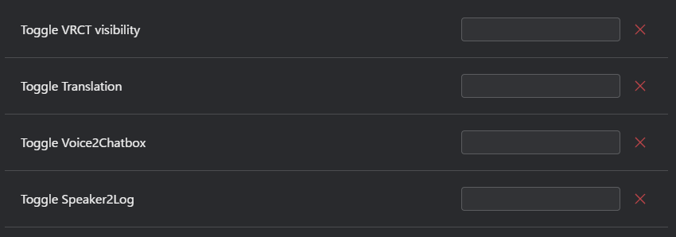

import TwitterEmbed from '@site/src/components/TwitterEmbed';

# ホットキータブ
VRCTコンフィグのホットキータブでさまざまなホットキー設定をカスタマイズします。

## ビデオ

<TwitterEmbed url="https://twitter.com/Shiina_12siy/status/1882028408185712799" />

## 一般

- **VRCTの最小化/アクティブ化の切り替え**: VRCTウィンドウを表示または非表示にするホットキーを設定します。
- **「翻訳」 オン/オフの切り替え**: 翻訳機能を有効または無効にするホットキーを設定します。
- **「マイク入力」 オン/オフの切り替え**: マイク入力（Voice2Chatbox）機能を有効または無効にするホットキーを設定します。
- **「聞き取り」 オン/オフの切り替え**: 聞き取り（Speaker2Log）機能を有効または無効にするホットキーを設定します。

:::info[注意]
- コンフィグウィンドウが開いている間は、ホットキーが一時的に無効になります。ホットキーの設定中にキーを押しても、意図しない動作が起きないようにするためです。
- ホットキーが、VRCT内の他のホットキーや、他のアプリケーションで既に使われている場合は、エラーが表示され、そのホットキーは登録されません。
:::
