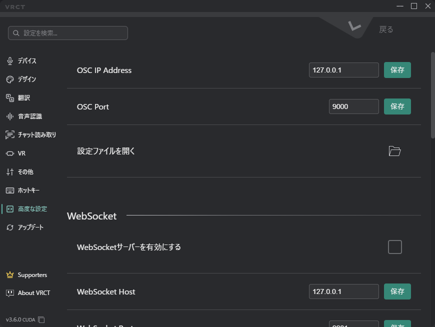
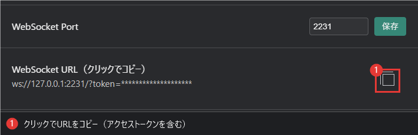

# 高度な設定タブ
VRCTコンフィグの高度な設定タブで詳細オプションを構成します。

:::info[CPU版/GPU版]
VRCTのCPU版とGPU版（CUDA）の切り替えは、[アップデートタブ](./config-updater)で行います。
:::

## 一般

- **OSC IP Address**: OSC通信用のIPアドレスを設定します。
- **OSCポート**: OSCメッセージ送信用のポート番号を指定します。
- **コンフィグファイルを開く**: 手動編集用のVRCTコンフィグファイルを開きます。

## WebSocket

- **WebSocketサーバーを有効にする**: WebSocket通信を有効または無効にします。
    - [OBSブラウザソース](/docs/feature-guide/obs-browser-source)が有効な間は、この設定を変更できません。
- **WebSocketホスト**: WebSocket通信用のIPアドレスを設定します。
    - `0.0.0.0`や`::`のようなワイルドカードアドレスは使用できません。
- **WebSocketポート**: WebSocket通信用のポート番号を指定します。
- **WebSocket URL（クリックでコピー）**: アクセストークンを含む接続URLをクリップボードにコピーします。
    - URLは`ws://127.0.0.1:2231/?token=...`のような形式です。
    - クライアントは`token`パラメーターを含める必要があります。トークンが正しくない接続は拒否されます。

外部アプリケーションからWebSocketサーバーを使う方法は、[WebSocket連携](/docs/feature-guide/websocket-integration)を参照してください。

## OBSブラウザソース（v3.5.0〜）

VRCT内蔵のHTTPサーバーで、OBSのブラウザソース用の字幕ページを配信します。

- **OBSブラウザソースを有効にする**: 内蔵HTTPサーバーを起動または停止します。
- **ポート**: 字幕ページを配信するポート番号を指定します。
- **文字色**: ブラウザソースに表示される字幕テキストの色を指定します。

:::note
字幕ページの表示にはWebSocketサーバーが使用されるため、あわせて有効にしてください。設定手順とOBS側の追加方法は[OBSブラウザソース](/docs/feature-guide/obs-browser-source)を参照してください。項目名やデフォルト値はコンフィグウィンドウの表示に従ってください。
:::

{/* TODO(v3.5.0): replace with ./img/config-advanced-obs.png */}

