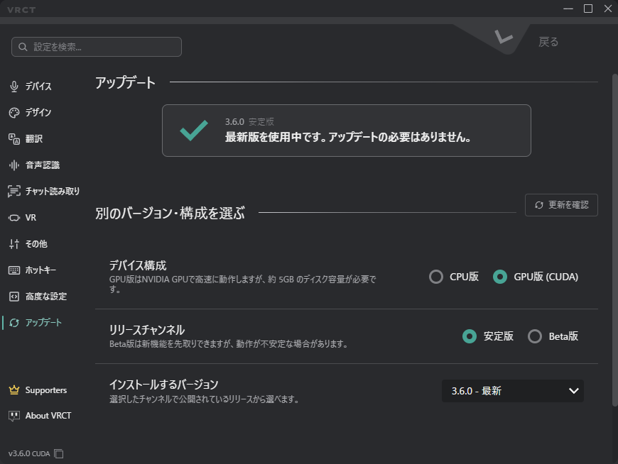

# アップデートタブ
コンフィグウィンドウのアップデートタブで、VRCTの更新を確認し、バージョンを選んでインストールします。この1つの画面で、リリースチャンネル、CPU版/GPU版、インストールするバージョンを選べます。以前のバージョンへ戻すこともできます。

新しいバージョンがある場合は、メインウィンドウにアップデートのお知らせが表示されます。これを選択すると、同じ画面がポップアップで開きます。

:::info[v3.6.0以降]
以前のバージョンを選んでインストールできるのは、v3.6.0以降です。この画面からv3.6.0より前のバージョンへ戻すことはできません。
:::

## 現在の状態
タブの上部には、実行中のバージョン、デバイス構成（CPU版またはGPU版）、リリースチャンネル（安定版またはβ版）が表示されます。  
最新バージョンを使用している場合は、アップデートが不要であることが表示されます。

## バージョン・構成の選択

インストールする構成を選びます。

- **リリースチャンネル**：**安定版**または**β版**を選びます。
    - β版は先行して新機能を試せますが、安定性は低い場合があります。
    - チャンネルを切り替えると、今後のアップデート通知が選んだチャンネルのリリースに従うようになります。切り替え時には注意が表示されます。
- **デバイス構成**：**CPU版**または**GPU版 (CUDA)**を選びます。
    - **GPU版 (CUDA)** は、NVIDIA GPUで速く動作する場合がありますが、追加で約5GBのダウンロードとディスク容量が必要です。
- **インストールするバージョン**：インストールするリリースを選びます。一覧には、選んだチャンネルのリリースが表示されます。
    - 過去のリリースを選ぶとダウングレードできます。ダウングレードすると、設定ファイルの互換性は保証されません。
    - 選んだチャンネルでリリースがない場合は、その旨が表示されます。

リリースの一覧を更新するには、**アップデートを確認**を押します。

## 変更内容の確認
インストールする前に、**現在**の構成と**インストール後**の構成を比較した表で、変わる内容を確認できます。

次の場合は、注意が表示されます。
- 以前のバージョンへダウングレードする場合
- GPU版 (CUDA) に切り替える場合（追加のダウンロードが必要です）
- リリースチャンネルを切り替える場合

## インストール
ボタンの表示は、選んだ内容に合わせて変わります。

- **最新版に更新**：最新バージョンを選んでいる場合に表示されます。
- **この設定でインストール**または**この設定で再インストール**：過去のバージョン、別のデバイス構成、同じバージョンで設定が違う場合など、それ以外の選択をしたときに表示されます。

## 関連項目
- [インストール](/docs/installation)：VRCTを初めてインストールする方法
- [高度な設定タブ](./config-advanced)：設定ファイルとネットワークの設定
