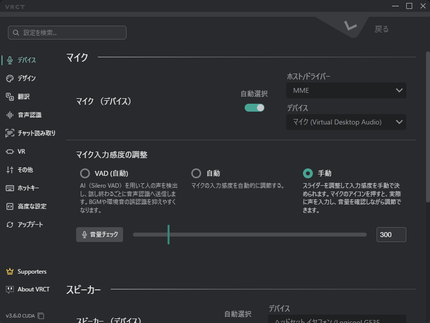

# コンフィグウィンドウの概要

コンフィグウィンドウを使用すると、外観から翻訳エンジンまで、VRCTのさまざまな側面をカスタマイズできます。   
メインウィンドウの**ギアアイコン（⚙️）**をクリックして開きます。

## 設定の検索
コンフィグウィンドウ上部の検索バーで、設定を名前から探せます。検索結果には、その設定があるタブが表示されます。

## デバイスタブ
オーディオ入力および出力デバイスと、マイク感度のモード（VAD、自動、手動）を管理します。  
詳細については、[デバイスタブ](./config-device)ページを参照してください。

## デザインタブ
アプリケーションのルック・アンド・フィールをカスタマイズします。  
詳細については、[デザインタブ](./config-appearance)ページを参照してください。

## 翻訳タブ
翻訳エンジンを構成します。「AI翻訳（ローカル）」「外部翻訳API」「ローカルLLM・互換サーバー」の3つのセクションに分かれています。  
詳細については、[翻訳タブ](./config-translation)ページを参照してください。

## 音声認識タブ
文字起こしエンジンを構成します。  
詳細については、[音声認識タブ](./config-transcription)ページを参照してください。

## チャット読み取りタブ
画面上のVRChatチャット吹き出しを読み取る方法（元の言語、キャプチャ対象、認識のしきい値）を構成します。  
詳細については、[チャット読み取りタブ](./config-chat-transcribe)ページを参照してください。

## VRタブ
VR関連（主にオーバーレイと、VR UI（β版））の設定を構成します。  
詳細については、[VRタブ](./config-vr)ページを参照してください。

## その他のタブ
その他の雑多な設定を構成します。  
詳細については、[その他タブ](./config-other)ページを参照してください。

## ホットキータブ
VRCTのさまざまなアクションのキーボードショートカットを構成します。  
詳細については、[ホットキータブ](./config-hotkeys)ページを参照してください。

## 高度な設定タブ
VRCTの詳細構成オプション（WebSocketサーバーを含みます）。  
詳細については、[高度な設定タブ](./config-advanced)ページを参照してください。

## アップデートタブ
更新の確認、リリースチャンネルとCPU版/GPU版の選択、特定のバージョンのインストールを行います。  
詳細については、[アップデートタブ](./config-updater)ページを参照してください。
